# Kuadri

**Tu panel personal para organizar estudio, tiempo y metas.**

Kuadri es una aplicación web full stack para organizar tareas y entregas, recibir recordatorios automáticos, medir el tiempo de estudio con un temporizador de enfoque y mantener la constancia con rachas y logros. Su diseño propio es plano y alegre, en verde lima, negro y blanco, y funciona en celular y escritorio.

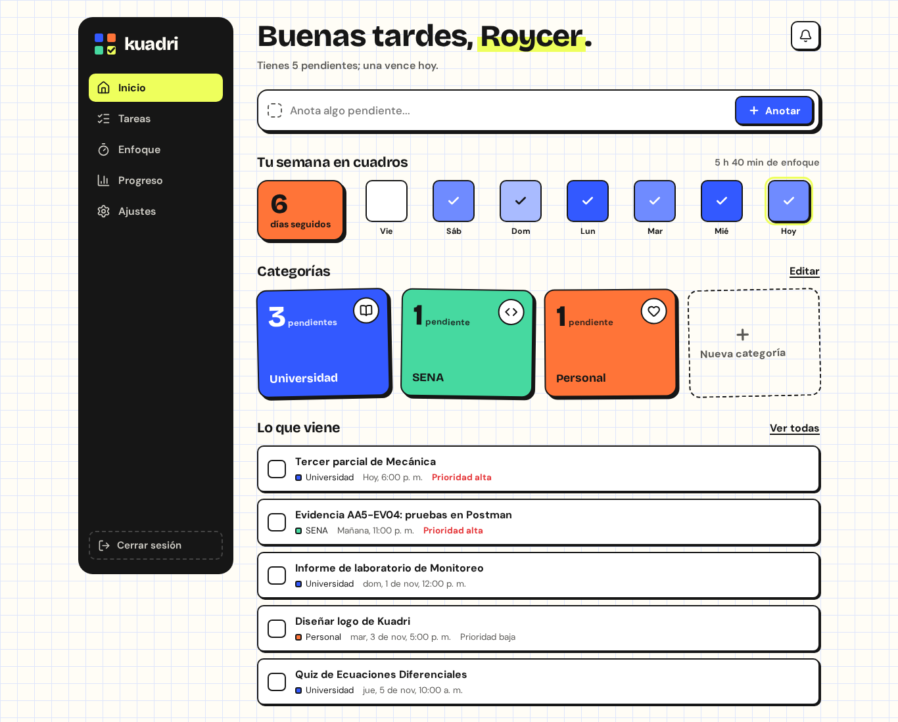

## Por qué la construí

Estudio en dos instituciones al mismo tiempo (Tecnólogo en Análisis y Desarrollo de Software en el SENA e Ingeniería en la Universidad del Magdalena) y tenía mis entregas repartidas entre mensajes, correos y notas. Kuadri nace de ese problema real: un solo lugar para ver qué viene, recibir avisos antes de cada fecha y saber cuánto estudio de verdad cada semana.

## Funcionalidades

### Fase 1: organización y estudio

- **Cuentas de usuario** con registro, inicio de sesión y contraseñas cifradas.
- **Categorías personalizables** (nombre, color e icono). Al registrarse se crean Universidad, SENA y Personal.
- **Tareas** con fecha límite, prioridad y categoría, en **vista de lista** con filtros y en **vista de calendario** mensual.
- **Recordatorios automáticos**: un planificador revisa cada 15 minutos las entregas que vencen en las próximas 24 horas y avisa dentro de la app y por correo.
- **Temporizador de enfoque** de 15, 25, 50 o 90 minutos, asociado opcionalmente a una tarea.
- **Estadísticas de los últimos 7 días**: minutos de enfoque y tareas completadas por día.
- **Rachas y logros** que se calculan y otorgan automáticamente.
- **Notificaciones** dentro de la app.
### Fase 2: metas y lista de deseos

- **Metas personales** con fecha objetivo, categoría y pasos. La barra de avance se llena sola a medida que marcas los pasos, y la meta se cumple cuando terminas todos.
- **Lista de deseos** con enlace de la tienda, foto, prioridad y el precio que quieres pagar.
- **Seguimiento de precios**: anotas el precio cada vez que lo ves y la app guarda el historial, muestra una gráfica, dice si bajó o subió y avisa en las notificaciones cuando llega a tu precio objetivo.
- Dos logros nuevos: **Soñador** (cumplir una meta) y **Paciente** (un deseo llega a tu precio).

### Fase 3: estudio creativo y registro de ocio

- **Paletas de colores** de 2 a 6 colores. Al tocar un color se copia su código.
- **Tipografías** de Google Fonts con vista previa dentro de la app y el uso de cada una (títulos, texto o ambos).
- **Plantillas** que juntan una paleta con una fuente para títulos y otra para texto, con una tarjeta de ejemplo.
- **Registro de ocio** para videojuegos, series, películas, libros y música, con estado, nota de 1 a 5 estrellas y los ratos que les dedicas.
- **Equilibrio de la semana** en Progreso: qué parte del tiempo fue estudio (enfoque) y qué parte fue ocio.
- Dos logros nuevos: **Creativo** (primera paleta) y **Equilibrado** (terminar algo de tu lista de ocio).

### Diseño

- **Diseño propio** en verde lima, negro y blanco, con tarjetas sólidas y píldoras: la semana se llena cuadro por cuadro y el temporizador avanza en una cuadrícula.
- **Diseño adaptable** a celular, tableta y escritorio, con navegación inferior en celular y un menú "Más" para las demás secciones.
- **Se instala como app** en la pantalla principal del celular, con un aviso que explica cómo hacerlo.

## Capturas

| Estudio: paletas | Estudio: plantillas |
|---|---|
| 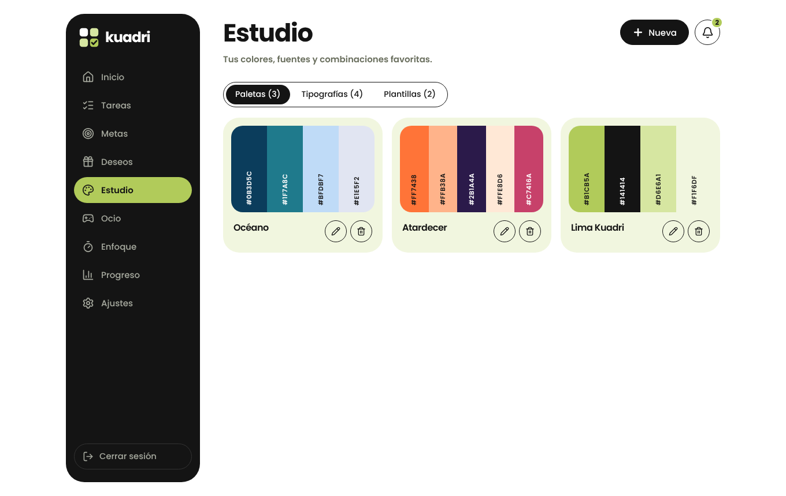 | 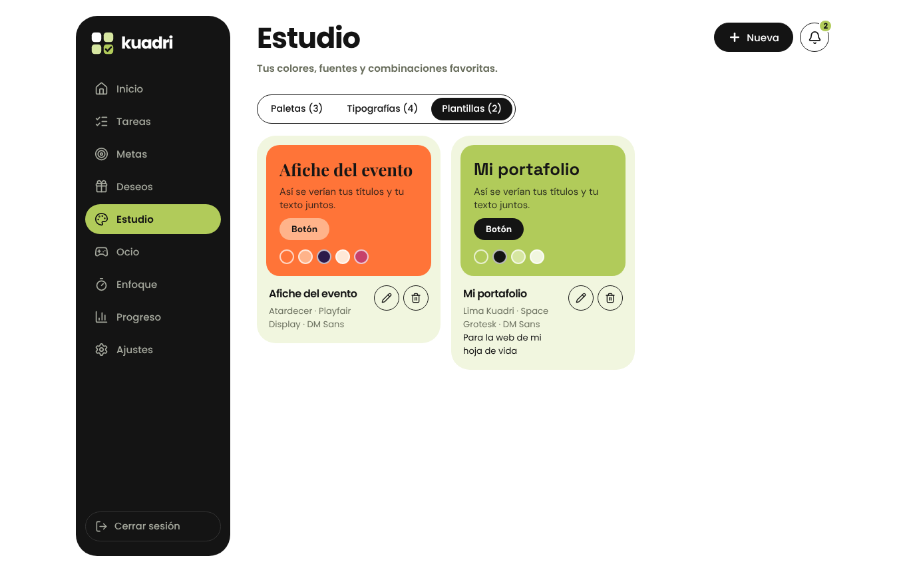 |

| Registro de ocio | Celular: paletas | Celular: menú Más |
|---|---|---|
| 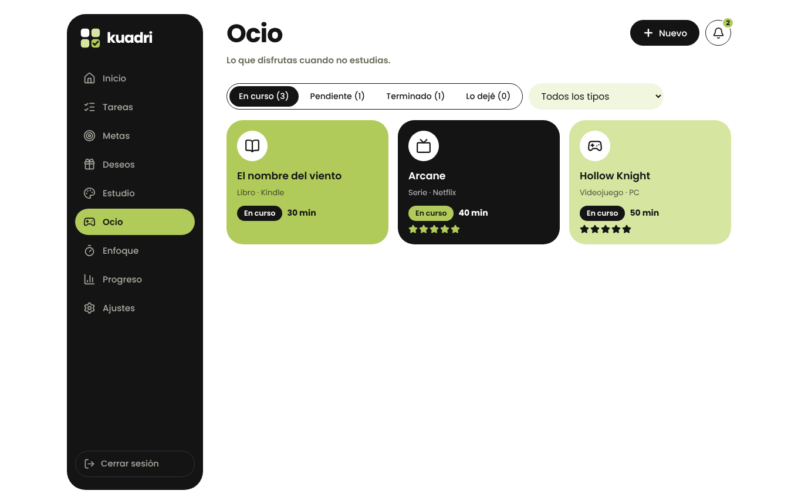 | 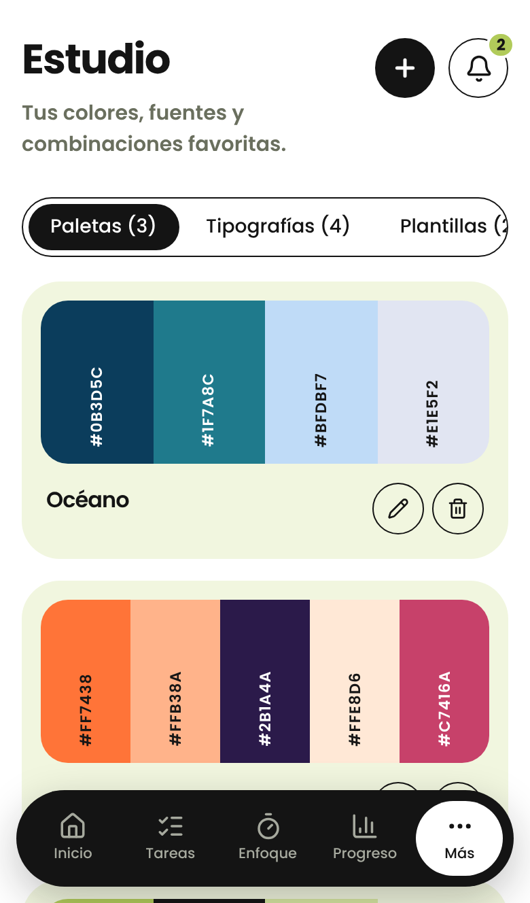 | 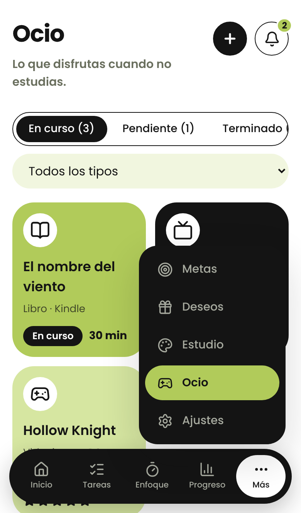 |

| Metas con pasos | Deseo con historial de precios |
|---|---|
| 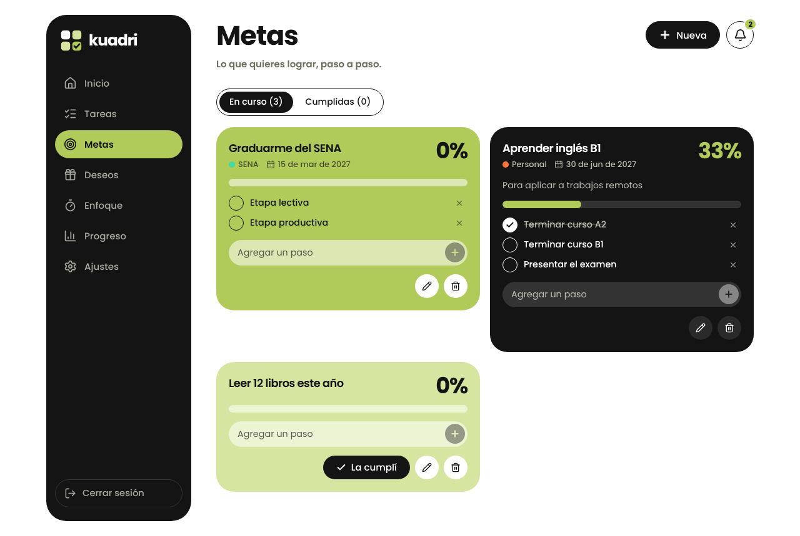 | 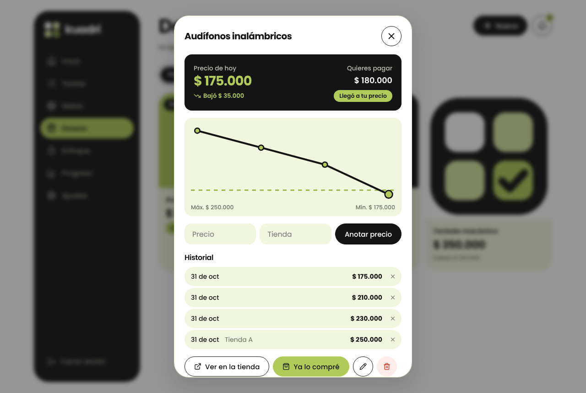 |

| Tareas en calendario | Progreso y logros |
|---|---|
| 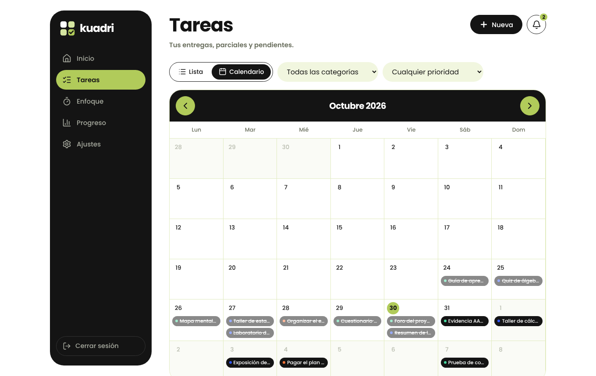 | 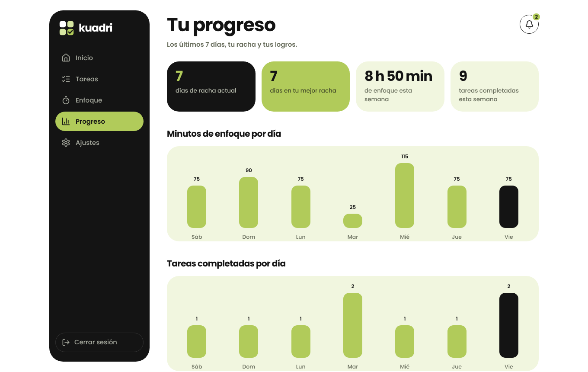 |

| Enfoque | Inicio de sesión |
|---|---|
| 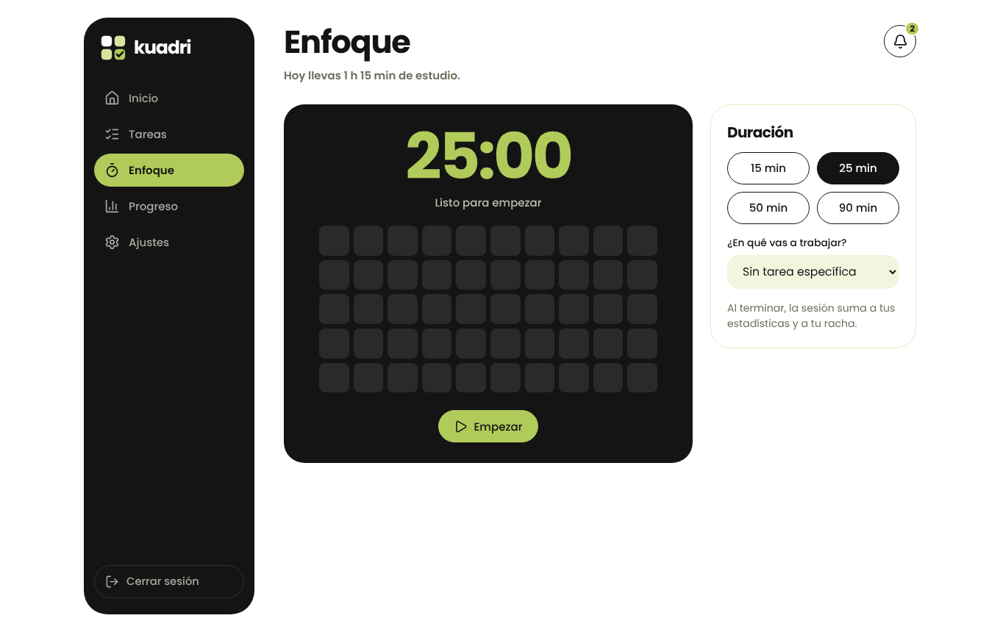 | 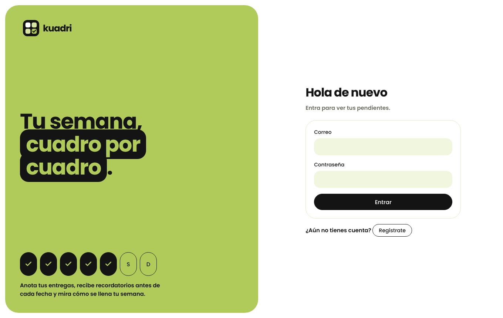 |

| Celular: inicio | Celular: tareas | Celular: progreso |
|---|---|---|
| 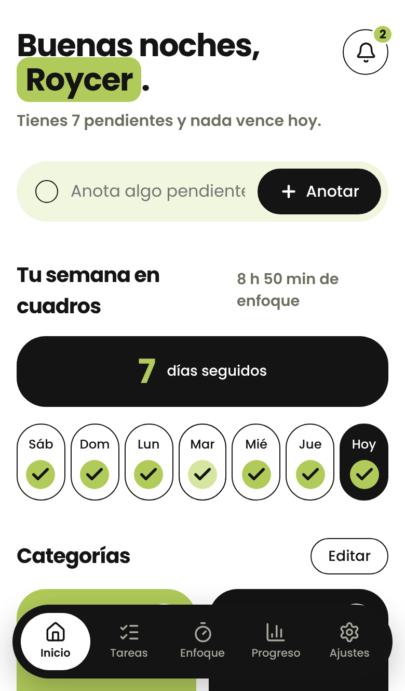 | 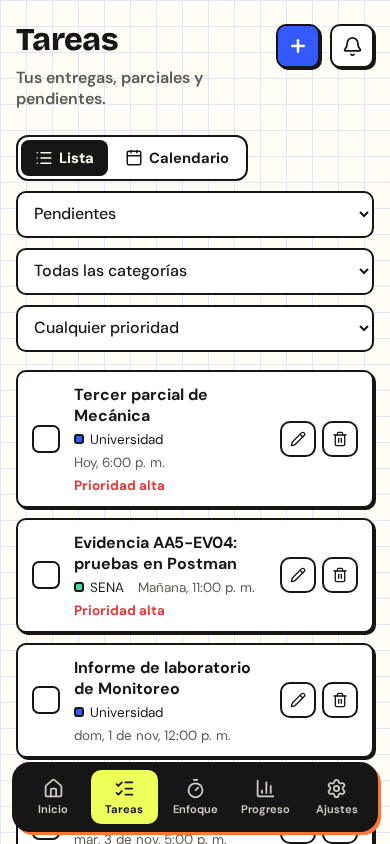 | 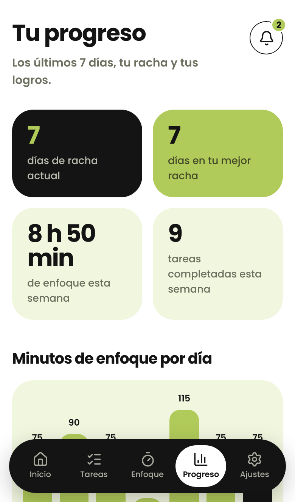 |

| Celular: nueva tarea | Celular: instalar como app |
|---|---|
| 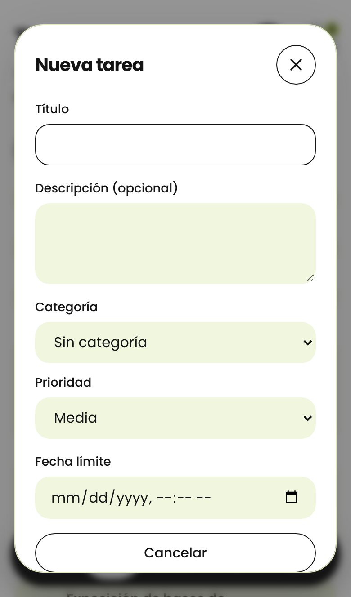 | 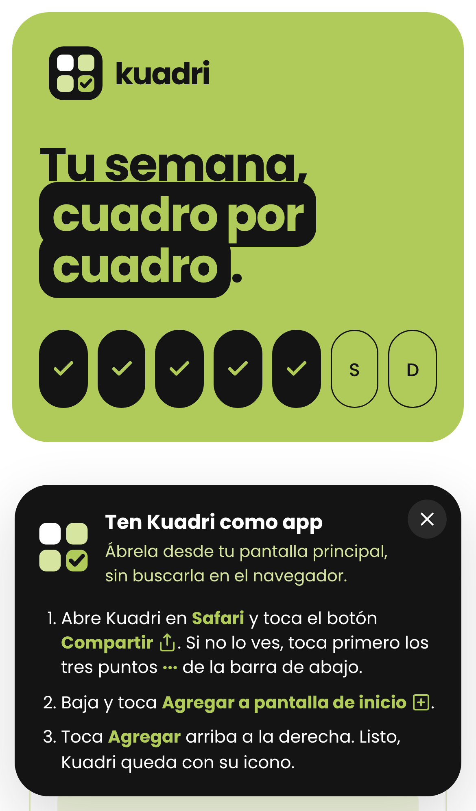 |

## Tecnologías

| Capa | Tecnologías |
|---|---|
| Front-end | React 19, Vite, React Router, CSS propio (sistema de diseño "lima"), Lucide Icons |
| Back-end | Node.js, Express 5, JWT, bcrypt, Helmet, node-cron, Resend / Nodemailer |
| Base de datos | MySQL 8 (compatible con MariaDB) |
| Pruebas | Jest y Supertest (API), Vitest y Testing Library (interfaz) |
| Integración continua | GitHub Actions con MySQL como servicio |
| Diseño | Diagramas UML y modelo entidad-relación en Mermaid |

## Arquitectura

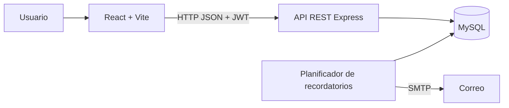

La API está organizada por capas: **rutas** (URLs y middlewares), **controladores** (reciben la petición y responden), **servicios** (reglas de negocio como rachas y logros) y **modelos** (consultas SQL parametrizadas). Todas las respuestas usan el mismo formato `{ ok, data, mensaje }`.

Más detalle en la documentación:

- [Documento de análisis](docs/01-analisis.md): requisitos, historias de usuario, casos de uso y reglas de negocio.
- [Documento de diseño](docs/02-diseno.md): arquitectura, diagramas UML, modelo entidad-relación, servicios de la API y sistema de diseño.
- [Plan de pruebas](docs/03-pruebas.md): qué se prueba y cómo.
- [Guía de despliegue](docs/04-despliegue.md): cómo publicarla en internet.

## Seguridad

- Contraseñas cifradas con bcrypt.
- Autenticación con JWT en todas las rutas privadas.
- Cada usuario solo puede ver y modificar sus propios datos (validado en cada consulta).
- Consultas SQL parametrizadas contra inyección SQL.
- Validación de datos en el cliente y en el servidor.
- Encabezados de seguridad con Helmet y CORS restringido al dominio del front-end.
- Variables sensibles en archivo `.env`, fuera del repositorio.

## Cómo ejecutarlo en tu computador

Requisitos: Node.js 18 o superior y MySQL 8 (o MariaDB).

**1. Clonar el repositorio**

```bash
git clone https://github.com/royzeer/kuadri.git
cd kuadri
```

**2. Configurar y crear la base de datos**

```bash
cd backend
npm install
cp .env.example .env      # en Windows: copy .env.example .env
```

Abre el archivo `.env` y escribe tu usuario y contraseña de MySQL en `DB_USER` y `DB_PASSWORD`. Luego crea la base de datos:

```bash
npm run db:init
```

**3. Iniciar la API**

```bash
npm run dev
```

La API queda en `http://localhost:4000/api`.

**4. Iniciar la interfaz** (en otra terminal)

```bash
cd frontend
npm install
npm run dev
```

Abre `http://localhost:5173`, crea tu cuenta y empieza a usar Kuadri.

**Correos de recordatorio:** si no configuras las variables `SMTP_*`, los correos se muestran en la consola de la API. Para enviarlos de verdad, usa los datos SMTP de tu proveedor de correo.

## Publicación

Kuadri está preparada para publicarse con planes gratuitos: la base de datos en Aiven (MySQL), la API en Render y la interfaz en Vercel. La guía paso a paso está en [docs/04-despliegue.md](docs/04-despliegue.md).

## Pruebas

```bash
cd backend && npm test     # 59 pruebas: lógica de rachas, logros, metas, precios, estudio y ocio, correo, API completa y recordatorios
cd frontend && npm test    # 38 pruebas: utilidades de fechas, precios, fuentes y ocio, formularios, aviso de instalación
```

Las pruebas de la API usan una base de datos aparte (`kuadri_test`) que se crea sola. En GitHub Actions todas las pruebas se ejecutan automáticamente en cada cambio.

## Servicios de la API

| Método | Ruta | Descripción |
|---|---|---|
| POST | /api/auth/registro | Crear cuenta |
| POST | /api/auth/login | Iniciar sesión |
| GET, PUT | /api/auth/perfil | Ver y actualizar perfil |
| GET, POST, PUT, DELETE | /api/categorias | Gestionar categorías |
| GET, POST, PUT, DELETE | /api/tareas | Gestionar tareas (con filtros) |
| PATCH | /api/tareas/:id/completar | Completar o reabrir una tarea |
| GET, POST, PUT, DELETE | /api/metas | Gestionar metas con sus pasos y avance |
| PATCH | /api/metas/:id/cumplir | Marcar una meta como cumplida o reabrirla |
| POST, PATCH, DELETE | /api/metas/:id/pasos | Agregar, marcar y quitar pasos |
| GET, POST, PUT, DELETE | /api/deseos | Gestionar la lista de deseos |
| PATCH | /api/deseos/:id/comprar | Marcar un deseo como comprado |
| POST, DELETE | /api/deseos/:id/precios | Anotar o borrar un precio del historial |
| GET, POST, PUT, DELETE | /api/estudio/paletas | Gestionar paletas de colores |
| GET, POST, PUT, DELETE | /api/estudio/tipografias | Gestionar tipografías de Google Fonts |
| GET, POST, PUT, DELETE | /api/estudio/plantillas | Gestionar plantillas (paleta y fuentes) |
| GET, POST, PUT, DELETE | /api/ocio | Gestionar el registro de ocio |
| POST, DELETE | /api/ocio/:id/ratos | Anotar o borrar un rato de ocio |
| POST | /api/enfoque | Registrar una sesión de enfoque |
| GET | /api/estadisticas/resumen | Resumen semanal (estudio y ocio), racha y totales |
| GET | /api/logros | Logros obtenidos y bloqueados |
| GET, PATCH | /api/notificaciones | Ver y marcar notificaciones |

## Estructura del proyecto

```
kuadri/
├── backend/
│   ├── src/
│   │   ├── config/        # variables de entorno y conexión a MySQL
│   │   ├── routes/        # definición de rutas
│   │   ├── controllers/   # reciben la petición y responden
│   │   ├── services/      # reglas de negocio (rachas, logros, correo)
│   │   ├── models/        # consultas SQL
│   │   ├── middlewares/   # autenticación y manejo de errores
│   │   ├── jobs/          # planificador de recordatorios
│   │   └── utils/         # validaciones y fechas
│   ├── scripts/           # creación de la base de datos
│   └── tests/             # pruebas unitarias y de integración
├── frontend/
│   └── src/
│       ├── api/           # cliente HTTP
│       ├── context/       # sesión del usuario
│       ├── components/    # componentes reutilizables
│       ├── pages/         # pantallas
│       └── utils/         # utilidades de fechas, precios, fuentes y ocio
├── database/
│   ├── schema.sql         # esquema completo de la base de datos
│   └── migraciones/       # cambios para bases que ya tienen datos
├── docs/                  # análisis, diseño, pruebas y capturas
└── .github/workflows/     # integración continua
```

## Hoja de ruta

- **Fase 1 (lista):** organización y estudio, recordatorios, enfoque, estadísticas, rachas y logros.
- **Fase 2 (lista):** metas personales con pasos y lista de deseos con historial de precios.
- **Fase 3 (lista):** estudio creativo (paletas, tipografías y plantillas) y registro de ocio (juegos, series, películas, libros y música).

## Metodología

Desarrollado con Scrum adaptado para una persona: sprints de una semana y tablero en GitHub Projects. El proceso siguió el ciclo de Análisis y Desarrollo de Software: análisis de requisitos, diseño (UML y modelo de datos), construcción, pruebas y documentación.

## Autor

**Roycer Stevan Cervantes Ropero**
Tecnólogo en formación en Análisis y Desarrollo de Software (SENA) · Santa Marta, Colombia

- GitHub: [royzeer](https://github.com/royzeer)
- LinkedIn: [roycer-cervantes](https://www.linkedin.com/in/roycer-cervantes)

## Licencia

MIT. Consulta el archivo [LICENSE](LICENSE).
