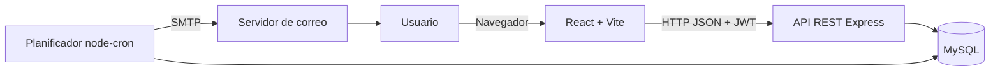
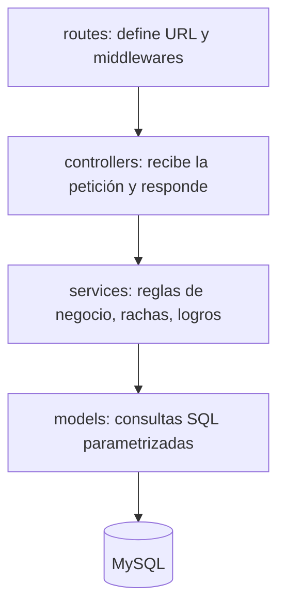
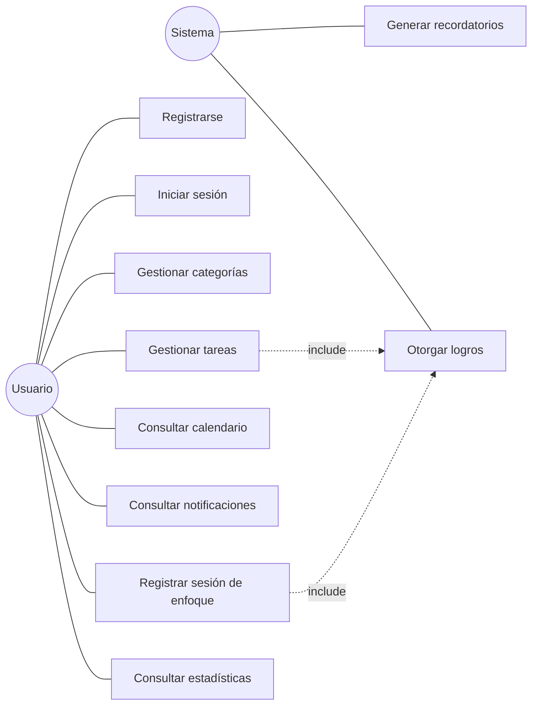
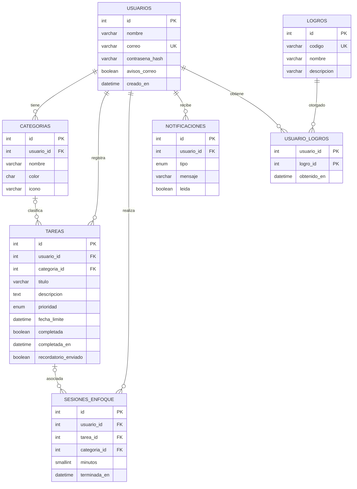
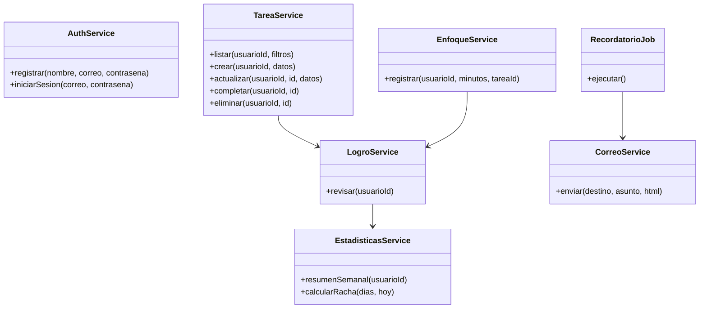
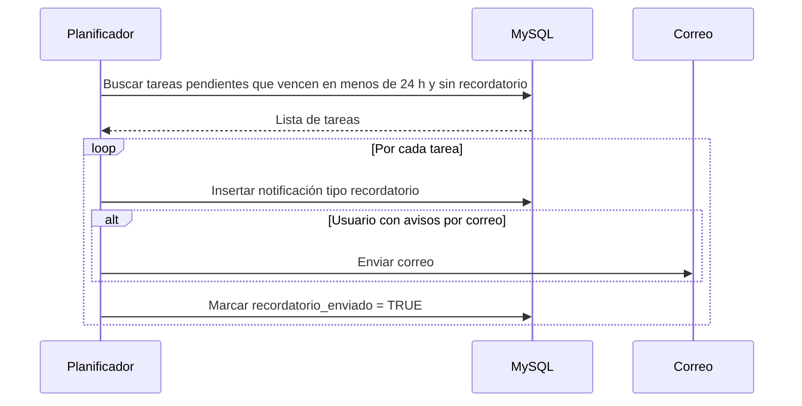
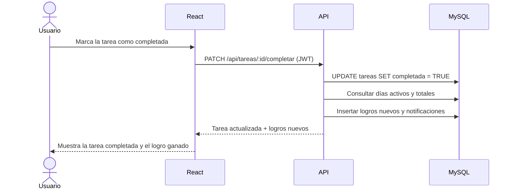

# Kuadri - Documento de diseño

Versión: 1.0 (Fase 1)

Los diagramas están escritos en Mermaid, por lo que GitHub los muestra como imágenes directamente en esta página.

## 1. Arquitectura

Arquitectura cliente-servidor de tres capas:

- **Cliente:** aplicación de una sola página (SPA) en React, construida con Vite.
- **Servidor:** API REST en Node.js con Express, organizada en rutas, controladores, servicios y modelos.
- **Datos:** base de datos MySQL.
- **Planificador:** tarea programada (node-cron) que corre dentro del servidor y genera recordatorios.

### Capas del servidor

## 2. Diagrama de casos de uso

## 3. Modelo entidad-relación

La base está normalizada hasta tercera forma normal: cada tabla describe una sola entidad, no hay grupos repetidos y los atributos dependen solo de la llave primaria. La vista `v_dias_activos` une tareas completadas y sesiones de enfoque para calcular rachas.

## 4. Diagrama de clases (servidor)

## 5. Diagrama de secuencia: recordatorio automático

## 6. Diagrama de secuencia: completar tarea

## 7. Servicios de la API

Todas las respuestas usan el formato `{ ok, data, mensaje }`. Las rutas marcadas con candado requieren el encabezado `Authorization: Bearer <token>`.

| Método | Ruta | Descripción | Auth |
|---|---|---|---|
| POST | /api/auth/registro | Crear cuenta | |
| POST | /api/auth/login | Iniciar sesión | |
| GET | /api/auth/perfil | Ver perfil | Sí |
| PUT | /api/auth/perfil | Actualizar nombre y avisos por correo | Sí |
| GET | /api/categorias | Listar categorías con conteo de tareas | Sí |
| POST | /api/categorias | Crear categoría | Sí |
| PUT | /api/categorias/:id | Editar categoría | Sí |
| DELETE | /api/categorias/:id | Eliminar categoría | Sí |
| GET | /api/tareas | Listar tareas (filtros: estado, categoria, prioridad, desde, hasta) | Sí |
| POST | /api/tareas | Crear tarea | Sí |
| PUT | /api/tareas/:id | Editar tarea | Sí |
| PATCH | /api/tareas/:id/completar | Marcar completada o pendiente | Sí |
| DELETE | /api/tareas/:id | Eliminar tarea | Sí |
| POST | /api/enfoque | Registrar sesión de enfoque | Sí |
| GET | /api/estadisticas/resumen | Resumen semanal, racha y totales | Sí |
| GET | /api/logros | Logros con estado obtenido o bloqueado | Sí |
| GET | /api/notificaciones | Listar notificaciones | Sí |
| PATCH | /api/notificaciones/leer-todas | Marcar todas como leídas | Sí |

## 8. Diseño de interfaz

**Concepto: "lima".** Interfaz plana y alegre sobre fondo blanco, con tarjetas de color sólido en verde lima y negro, esquinas muy redondeadas, botones y días de la semana en forma de píldora, y barras negras. El nombre Kuadri sigue viniendo de *cuadrícula*: la semana y el temporizador se llenan cuadro por cuadro.

| Token | Valor | Uso |
|---|---|---|
| Blanco | #FFFFFF | Fondo de la página |
| Negro | #141414 | Texto, barra lateral, botón principal, racha y día actual |
| Lima | #B1CB5A | Color principal: enlace activo, tarjetas, barras y logros |
| Lima clara | #D6E6A1 | Tarjetas y días con poco avance |
| Lima pálida | #F1F6DF | Fondo de tareas, campos y gráficos |
| Fuente | Poppins | Títulos y texto |

**Elementos propios del sistema**

- **Logo:** cuatro cuadritos en tonos de lima, uno marcado con un chulo: completar la cuadrícula.
- **Tu semana en cuadros:** siete píldoras con borde negro; el día se marca en lima según los minutos de enfoque y el día de hoy va en negro.
- **Categorías:** bloques de color sólido que alternan lima, negro y lima clara, con el número de pendientes en grande.
- **Temporizador en cuadrícula:** tarjeta negra con 50 cuadritos que se llenan en lima.
- **Gráficos de barras:** barras lima y la del día actual en negro.
- **Logros** como círculos lima y negros, punteados mientras están bloqueados.
- **Barra inferior en celular:** píldora negra con el elemento activo en un círculo blanco.

**Pantallas de la Fase 1:** inicio de sesión y registro (pantalla dividida), inicio, tareas (lista y calendario), enfoque, progreso y ajustes.
